# AWS CloudOps: Auto Scaling, Load Balancing & Operational Resilience

## Project Overview

This project demonstrates hands-on AWS infrastructure configuration, automation, monitoring, failure simulation, and recovery. It focuses on building and validating a resilient web-serving environment using EC2, Application Load Balancer (ALB), Auto Scaling Groups (ASG), IAM, S3, and Amazon CloudWatch.

The project includes IAM least-privilege access, secure S3 operations, lifecycle hook execution, CPU-based scaling, mixed Spot and On-Demand capacity, operational monitoring, and rollback of a misconfigured launch template.

## Technologies Used

- **Compute:** Amazon EC2
- **Identity and Access Management:** AWS IAM
- **Storage:** Amazon S3
- **Load Balancing:** Application Load Balancer (ALB)
- **Scaling and Availability:** EC2 Auto Scaling Groups
- **Cost Optimization:** EC2 Spot Instances and mixed instances policies
- **Monitoring:** Amazon CloudWatch
- **Automation and Validation:** AWS CLI, EC2 user data, `stress-ng`
- **Web Server:** Nginx

---

## 1. IAM — Roles and Least-Privilege Access

### Objectives
- Create an IAM role for EC2 and Auto Scaling.
- Attach appropriately scoped IAM policies.
- Validate resource-level permissions using the AWS CLI.

### Implementation

- Created an IAM role for EC2 and attached the required policies.
- Configured scoped permissions to restrict access to specified AWS resources.
- Validated access using the AWS CLI.

### Validation and Results

The EC2 role was configured to access a specific S3 bucket, `practise-bucket-12345`, rather than granting unrestricted S3 access.

Tested permitted and denied operations to verify that the role's effective permissions matched the intended access scope.

**Key learning:** IAM roles provide temporary credentials to AWS services, while least-privilege policies restrict what those services can access.

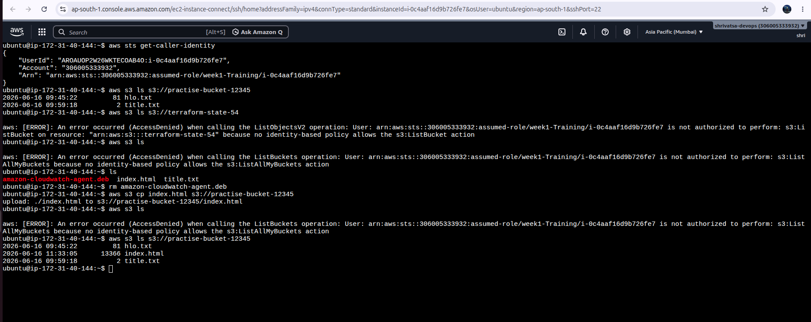

---

## 2. EC2 and Application Load Balancer

### Objectives
- Launch EC2 instances behind an Application Load Balancer.
- Configure target groups and health checks.
- Validate application accessibility through the ALB DNS name.
- Simulate an unhealthy instance and observe the resulting behavior.

### Implementation

- Launched a `t3.micro` EC2 instance running Nginx and serving a simple HTML page.
- Configured an Application Load Balancer operating at Layer 7.
- Created a target group using instance-based targets on port 80.
- Registered the EC2 instance (`i-0c4aaf16d9b726fe7`) with the target group.
- Configured health checks to monitor target availability.

### Validation and Results

- Accessed the application through the ALB DNS name and verified that Nginx served the HTML page.
- Stopped the EC2 instance to simulate an unhealthy target.
- Observed the target health transition and an HTTP 503 response when no healthy target was available to serve requests.

**Key learning:** An ALB routes requests to healthy registered targets. If no healthy target is available, it may return HTTP 503. The ALB does not itself restart a stopped EC2 instance; instance recovery requires a separate mechanism, such as Auto Scaling.

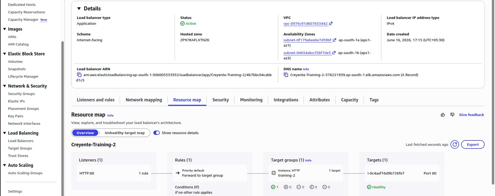

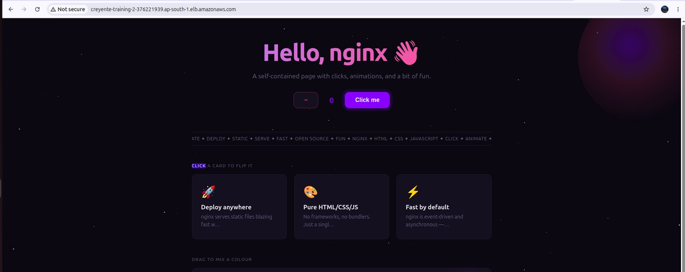

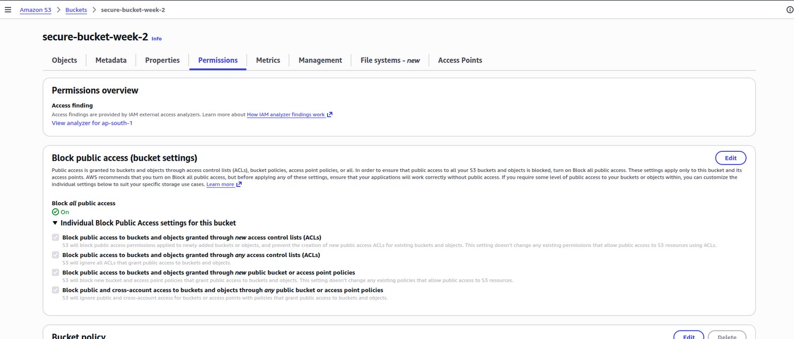

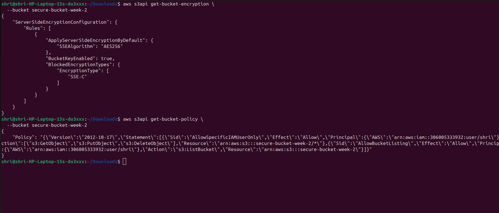

---

## 3. Amazon S3 — Secure Storage and Access Validation

### Objectives
- Create an S3 bucket with appropriate access controls.
- Upload, retrieve, and delete objects using the AWS CLI.
- Validate encryption and bucket policy configuration.

### Implementation

- Created the S3 bucket `secure-bucket-week-2`.
- Configured a bucket policy intended to restrict access to the IAM principal `shri`.
- Configured server-side encryption using Amazon S3 managed keys (SSE-S3).
- Tested object upload, download, and deletion through the AWS CLI.
- Inspected bucket policy and object metadata.

### Validation Commands

Inspect the bucket policy:

```bash
aws s3api get-bucket-policy \
  --bucket secure-bucket-week-2
```

Inspect object metadata and encryption:

```bash
aws s3api head-object \
  --bucket secure-bucket-week-2 \
  --key he.txt
```

### Results

Verified object operations and inspected the configured policy and encryption metadata through AWS CLI commands.

**Security note:** The original configuration had S3 Block Public Access disabled. For a production-oriented configuration, enable Block Public Access unless there is a documented requirement for public access. Validate the complete effective permissions, including IAM policies, bucket policies, and any applicable organization-level controls.

**Key learning:** Encryption at rest, authorization, and public-access prevention are separate security controls.

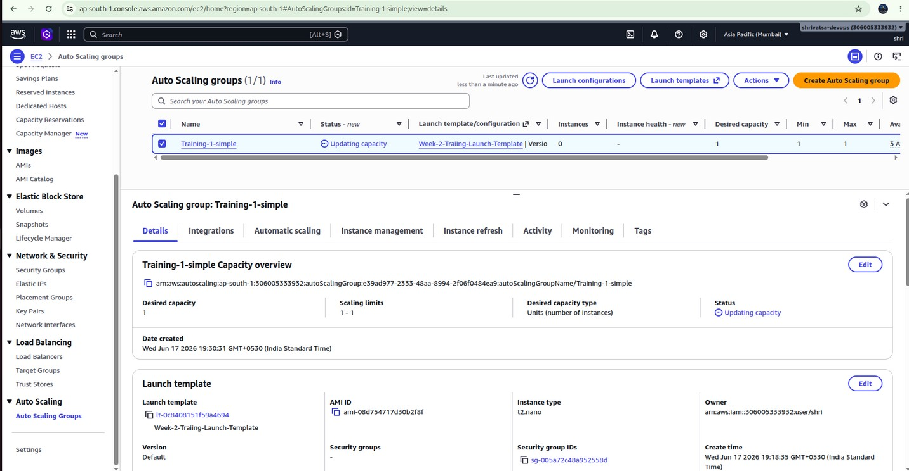

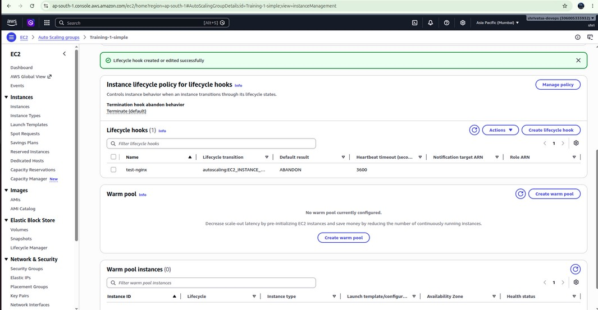

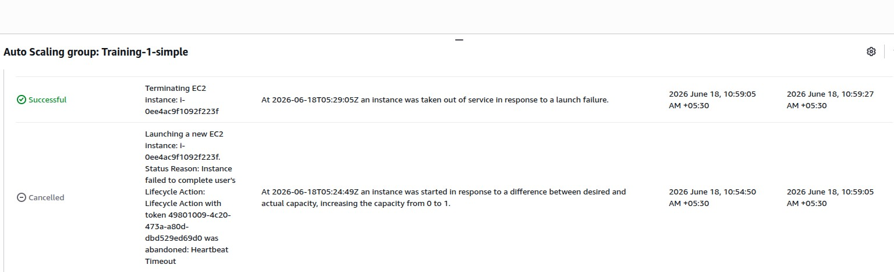

---

## 4. EC2 Auto Scaling Groups and Lifecycle Hooks

### Objectives
- Create an Auto Scaling Group using a preconfigured AMI and launch template.
- Configure minimum, desired, and maximum capacity.
- Implement CPU-based scaling.
- Understand lifecycle hooks and instance launch transitions.
- Validate configuration before allowing an instance to proceed to service.

### Implementation

#### 4.1 AMI and Launch Template

1. Created an Amazon Machine Image (AMI) from an existing EC2 instance containing the required software and configuration.
2. Created a launch template referencing the AMI.
3. Configured an IAM instance profile for the EC2 instances.
4. Selected the required networking, subnet, security group, and instance settings.
5. Created the Auto Scaling Group using the launch template.

#### 4.2 Capacity and Scaling Policy

Configured the following capacity settings:

| Setting | Value |
|---|---:|
| Minimum capacity | 1 |
| Desired capacity | 1 |
| Maximum capacity | 2 |
| Target CPU utilization | 50% |

Configured a target tracking scaling policy to maintain average CPU utilization around 50%.

#### 4.3 Lifecycle Hook Implementation

Configured a launch lifecycle hook named `test-nginx`.

- Initially configured the heartbeat timeout to 3,600 seconds.
- Later reduced it to 200 seconds for testing.
- Used the `ABANDON` lifecycle action result to observe what happens when a newly launching instance does not complete the lifecycle action successfully.
- Configured EC2 user data to perform the required initialization and signal `CONTINUE` after successful completion.

### Lifecycle Hook Validation

The intended launch sequence was:

1. A new EC2 instance launches.
2. The instance enters `Pending:Wait` while the lifecycle hook is active.
3. Initialization runs through the configured user data.
4. The lifecycle action completes with `CONTINUE`.
5. The instance proceeds through the remaining launch process and becomes `InService` once the required conditions are met.

To test the failure path, deliberately withheld lifecycle completion and observed the timeout and termination behavior associated with the configured `ABANDON` result.

Example lifecycle completion command:

```bash
aws autoscaling complete-lifecycle-action \
  --lifecycle-hook-name test-nginx \
  --auto-scaling-group-name Training-1-simple \
  --lifecycle-action-result CONTINUE \
  --instance-id i-032d60b11d97a78c3
```

In this implementation, the lifecycle action was also tested through the configured user data.

**Important distinction:** `CONTINUE` permits the instance to proceed through the lifecycle; it does not automatically prove that the application is healthy. Initialization scripts should check their commands' exit statuses before sending the signal, and ALB health checks should independently validate application readiness.

### Validation Results

- Observed the `Pending:Wait` lifecycle state.
- Verified progression after successful lifecycle completion.
- Tested the failure path when lifecycle completion was withheld.
- Used `stress-ng` to generate CPU load and trigger scale-out activity.

**Key learning:** Lifecycle hooks provide a controlled wait period for initialization, validation, and other launch or termination tasks before an instance proceeds through its lifecycle.


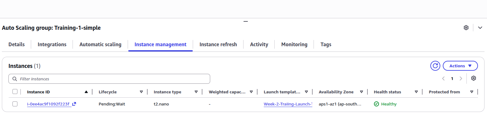

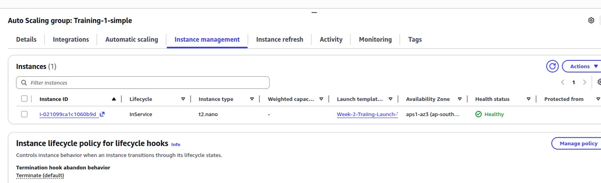

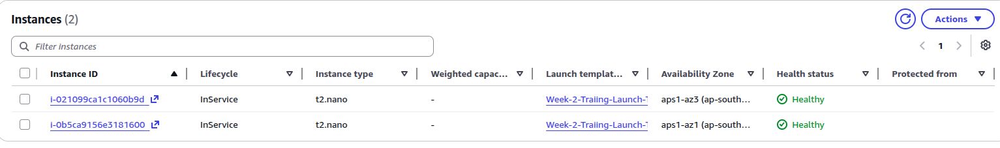

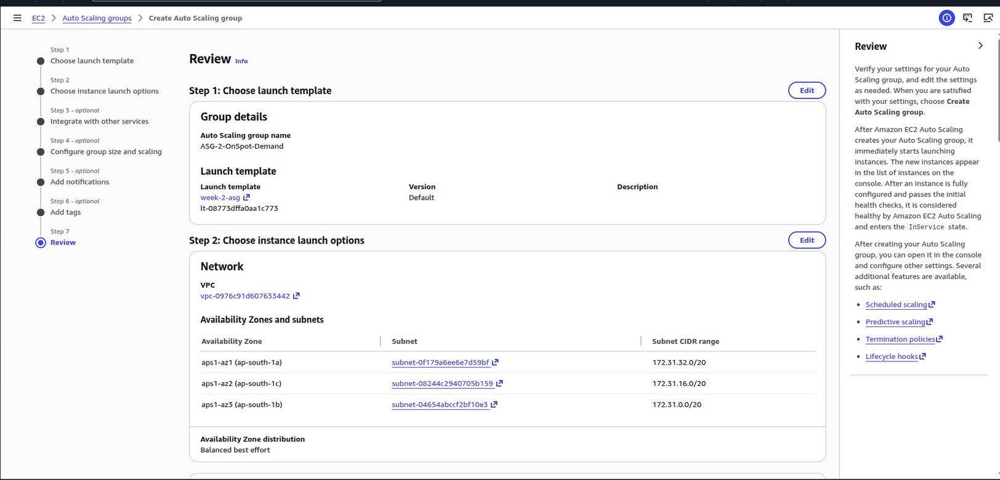

---

## 5. Spot Instances and Mixed Instances Policies

### Objectives
- Configure a multi-AZ Auto Scaling Group.
- Combine Spot and On-Demand capacity.
- Configure instance type diversity.
- Understand Spot interruption behavior and automatic instance replacement.

### Implementation

Configured an Auto Scaling Group across Availability Zones `1a`, `1b`, and `1c`, using the best-balanced distribution setting available in the selected configuration.

Capacity settings:

| Setting | Value |
|---|---:|
| Minimum capacity | 1 |
| Desired capacity | 1 |
| Maximum capacity | 4 |
| Target CPU utilization | 50% |

### Mixed Instances Policy

Configured a mixed instances policy with:

- A 50% On-Demand and 50% Spot capacity distribution.
- One base On-Demand capacity unit before additional capacity follows the configured distribution.
- Multiple instance type options, including `t2.nano`, `t3.nano`, `t2.micro`, and `t3.micro`.
- The `capacity-optimized` Spot allocation strategy.
- An Application Load Balancer and target group configured to serve traffic on port 80.

The purpose of instance type diversity was to improve the chances of obtaining available Spot capacity. The base On-Demand capacity was intended to provide a more reliable baseline.

### Spot Interruption Scenario

Reviewed and walked through the Spot interruption workflow.

- AWS generally provides a two-minute interruption notice before a Spot instance is terminated or stopped, where that notice applies.
- Reviewed Auto Scaling activity history to understand instance termination and replacement.
- Observed replacement behavior when an instance became unhealthy.
- Examined lifecycle hook failure and subsequent instance replacement.

**Operational consideration:** Spot instances can be interrupted, so workloads should tolerate interruption. Stateful services that cannot recover from termination should not rely on Spot instances alone. A mixed-capacity strategy, suitable health checks, and appropriate state management help reduce the impact.

### Validation Results

- Verified the Auto Scaling Group's multi-AZ configuration.
- Observed Spot instances being launched during scale-out.
- Inspected Auto Scaling activity history during replacement events.
- Reviewed the interaction between ALB target health, lifecycle hooks, and Auto Scaling replacement behavior.

**Key learning:** Mixed instances policies can balance cost and availability, but Spot capacity and interruption behavior remain dependent on AWS capacity conditions and configuration.

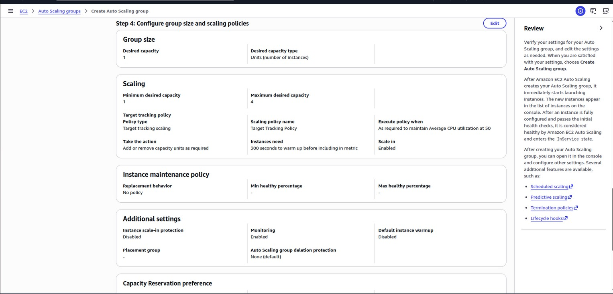

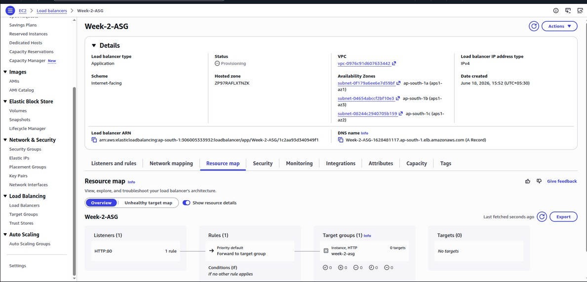


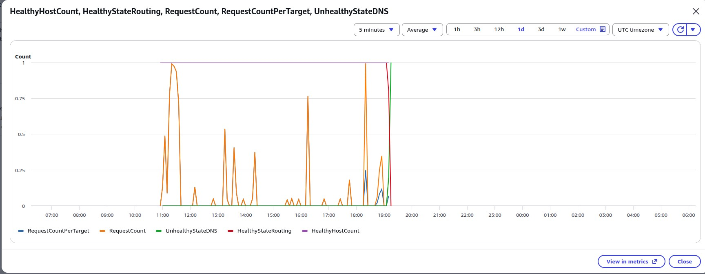

---

## 6. Operational Validation and CloudWatch Monitoring

### Objectives
- Monitor ALB request traffic and target health.
- Observe Auto Scaling activity and capacity changes.
- Inspect EC2 CPU utilization.
- Correlate scaling events with workload and lifecycle behavior.

### Monitoring Implemented

#### Application Load Balancer

Reviewed relevant ALB CloudWatch metrics, including:

- `HealthyHostCount`
- `UnHealthyHostCount`
- `RequestCount`
- `HealthyStateRouting`

These metrics help evaluate target availability, traffic volume, and healthy routing capacity. `HealthyStateRouting` is a routing-state metric rather than a direct measure of application latency.

#### Auto Scaling Group

Configured and inspected Auto Scaling monitoring for:

- Minimum, desired, and maximum group capacity.
- Instance launches and terminations.
- Capacity changes during scaling activity.
- Multi-AZ instance distribution.

#### EC2 CPU Utilization

Created and inspected CPU utilization graphs to validate that the generated workload increased CPU usage and triggered the configured scaling policy.

### Stress Testing and Scale-Out

Used `stress-ng` to generate CPU load on EC2 instances.

Observed the Auto Scaling Group scale out from one instance to two, and subsequently to four, while staying within the configured maximum capacity.

Reviewed instance transitions and lifecycle hook execution during these scaling events.

Also observed additional instances being launched across Availability Zones and Spot instances being used during scale-out under the configured mixed instances policy.

### Validation Results

- Correlated increased CPU utilization with scaling activity.
- Observed changes in Auto Scaling Group capacity.
- Reviewed launch and termination events.
- Validated instance distribution and replacement behavior.
- Used CloudWatch metrics and activity history to understand the relationship between load, health, and capacity.

**Key learning:** CloudWatch metrics show resource and traffic behavior, while Auto Scaling activity history helps explain why the group launched or terminated instances. Both are needed for effective operational troubleshooting.

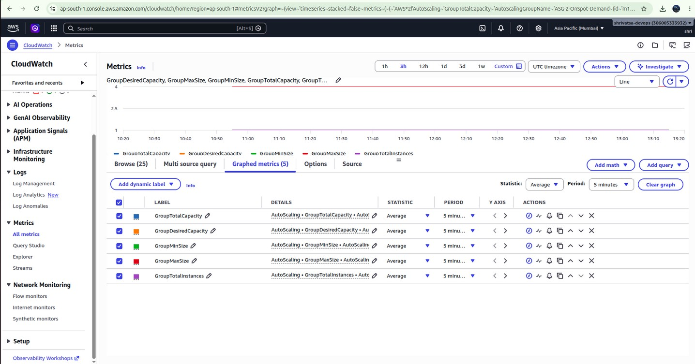

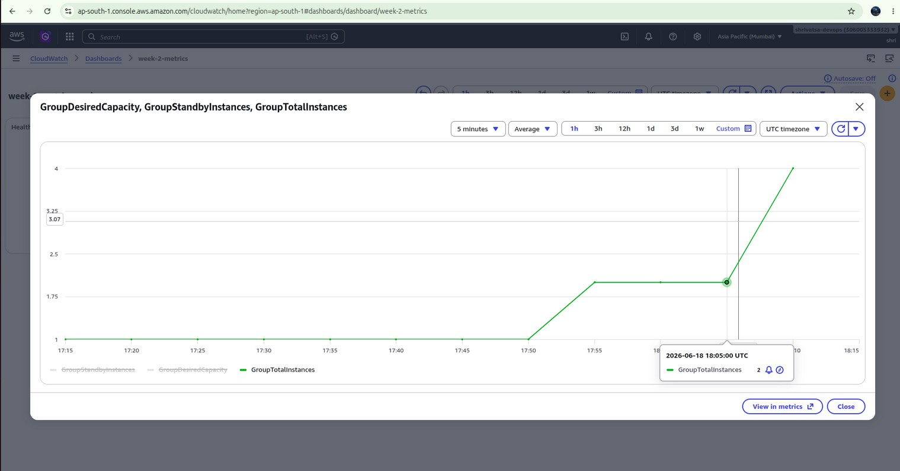

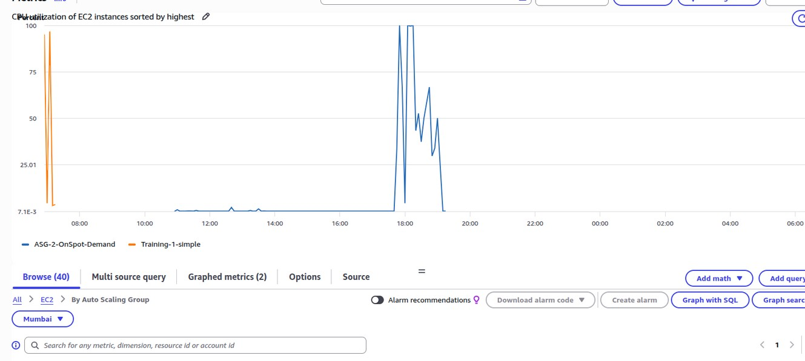

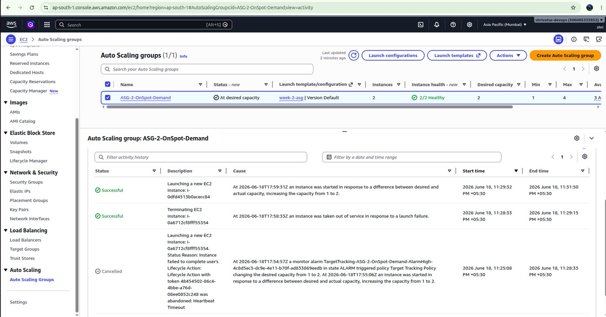

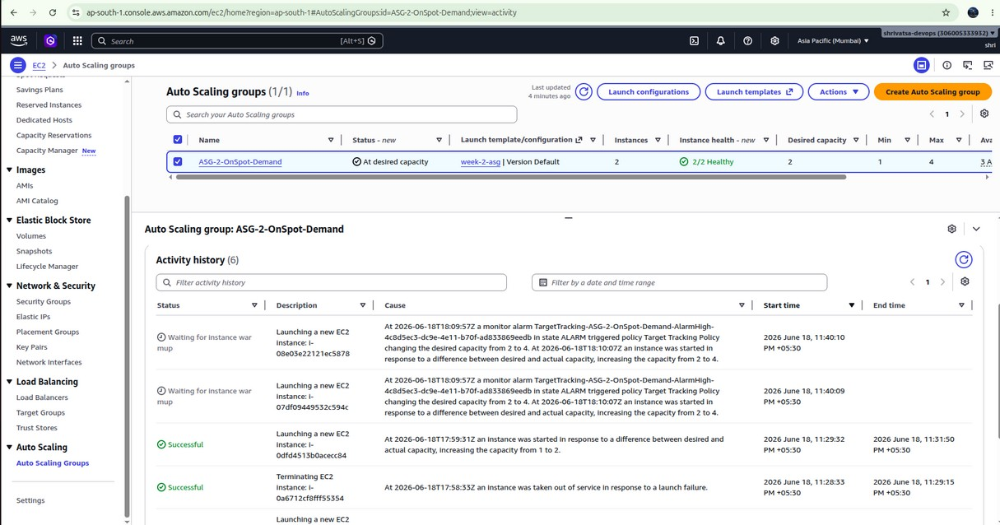

---

## 7. Safe Rollback of a Misconfigured Launch Template

### Objectives
- Simulate a launch configuration error.
- Observe the effect of an incorrect security group.
- Restore a known-good launch template version.
- Validate service availability during instance replacement.

### Implementation

Deliberately introduced a configuration error by attaching an incorrect security group in a new launch template version.

Deleted an instance to trigger replacement using the modified configuration, then observed the resulting instance and target health behavior.

After identifying the issue:

1. Changed the Auto Scaling Group's launch template version from version 2 back to version 1.
2. Triggered replacement of the affected instance.
3. Verified that the replacement instance used the restored security group configuration.
4. Confirmed the intended volume configuration, including the updated 9 GiB volume size.

### Validation Results

- Observed the impact of the incorrect security group on the replacement instance.
- Rolled back the launch template reference to a known-good version.
- Verified that the replacement instance used the restored configuration.
- Ran a simple loop to send requests to the ALB DNS name during the rollback.
- Observed that the `HealthyStateRouting` metric remained healthy throughout the tested rollback.

**Key learning:** Versioned launch templates make it possible to roll back instance configuration changes. The Auto Scaling Group must reference the intended version, and replacement instances must be checked to confirm that the rollback actually took effect.

A healthy routing metric during a test is useful evidence of continued routing capacity, but it does not by itself prove that every request succeeded or that there was zero downtime.

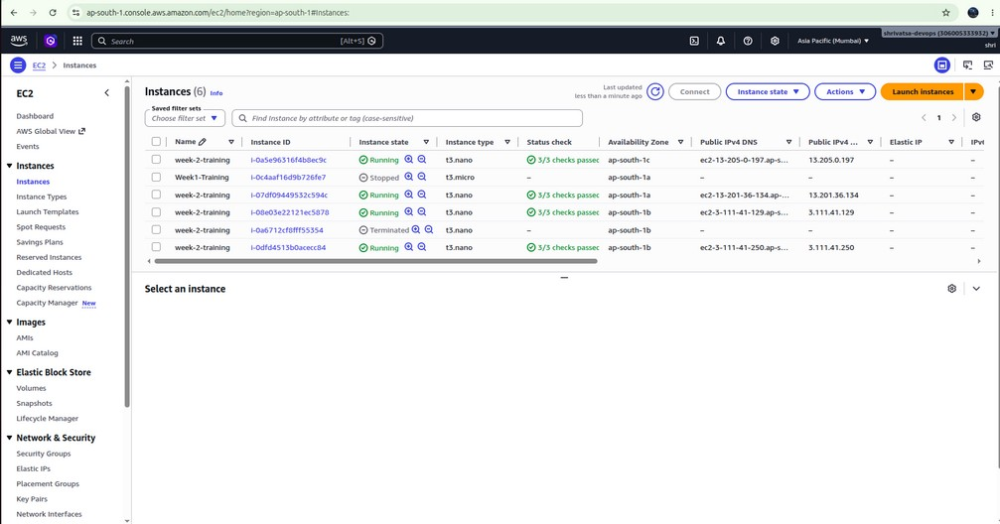

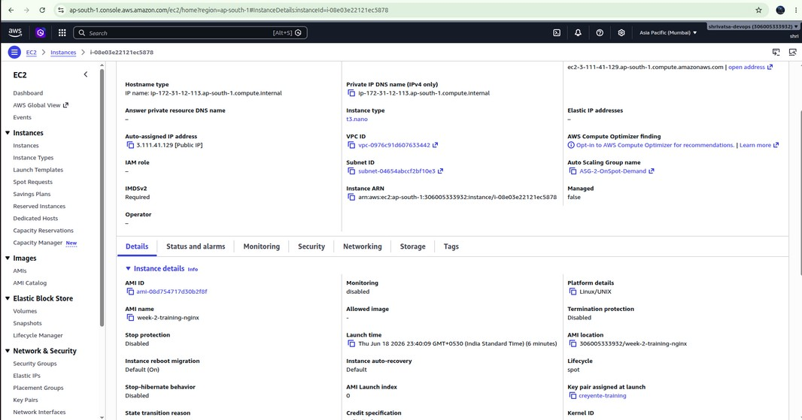

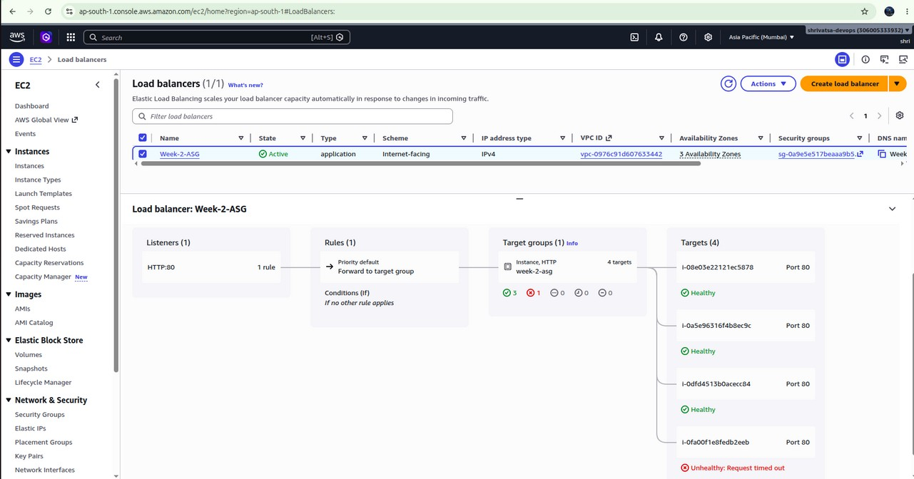

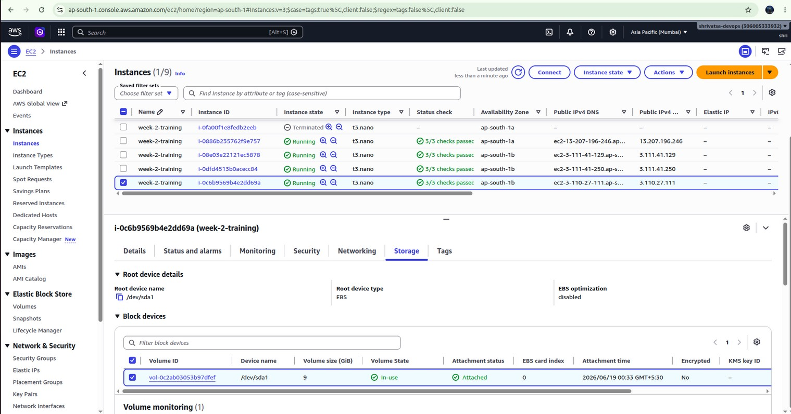

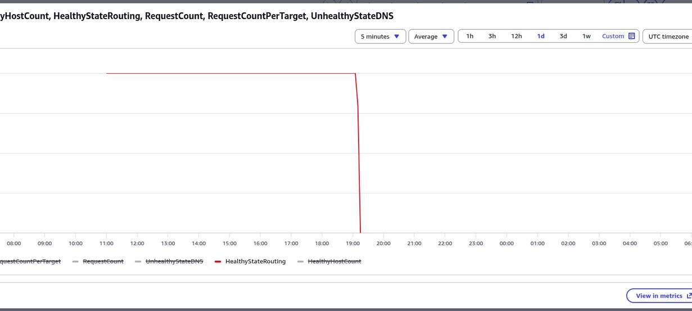


---

## 8. Key Learnings

Through this project, I gained hands-on experience with:

- Designing IAM roles and applying least-privilege access controls.
- Configuring S3 access policies, object operations, and server-side encryption.
- Deploying EC2-backed applications behind an Application Load Balancer.
- Configuring target groups, health checks, and traffic routing.
- Creating AMIs, launch templates, and Auto Scaling Groups.
- Implementing and validating EC2 Auto Scaling lifecycle hooks.
- Using CPU-based scaling to respond to simulated workload increases.
- Configuring mixed Spot and On-Demand capacity with multiple instance types.
- Monitoring resource utilization, target health, and scaling events through CloudWatch.
- Troubleshooting unhealthy instances and validating configuration rollback.
- Using AWS CLI commands and operational evidence to understand infrastructure behavior.

## Conclusion

This project focused on understanding how AWS compute, networking, identity, storage, scaling, and monitoring components work together.

Rather than only deploying infrastructure, I deliberately introduced failure scenarios, generated workload, inspected lifecycle transitions, and rolled back a misconfigured launch template. These exercises helped me understand how to validate infrastructure behavior and investigate failures using AWS CLI, Auto Scaling activity history, ALB health checks, and CloudWatch metrics.
